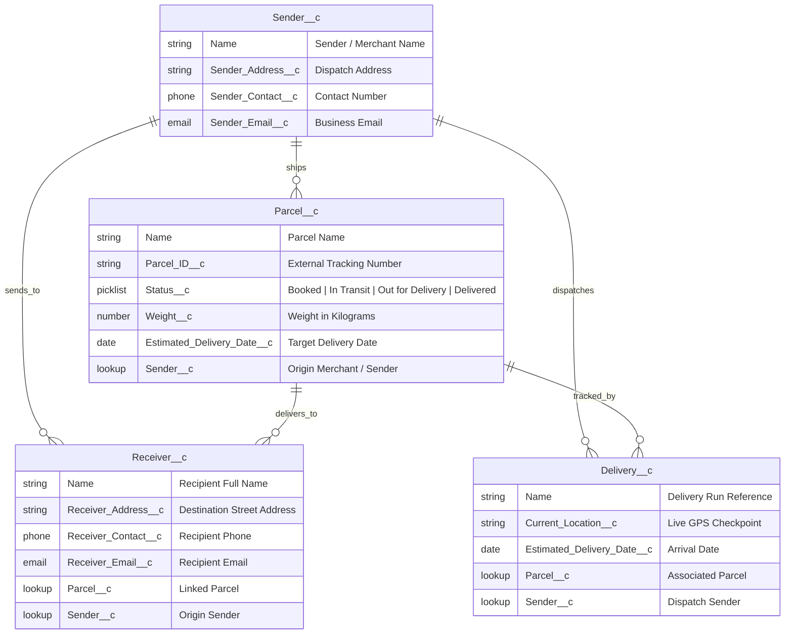

# ⚡ Swift Ship Tracker
### Conversational AI Parcel Booking, Tracking & Delivery Management on Salesforce CRM with Agentforce

[](https://developer.salesforce.com)
[](https://developer.salesforce.com/docs/platform/einstein-for-devs/guide/lexapp-overview.html)
[](https://developer.salesforce.com)
[]()

---

## 📌 Project Overview

**Swift Ship Tracker** is an end-to-end cloud logistics and parcel management platform built natively on **Salesforce CRM** with **Agentforce AI** and an interactive real-time tracking dashboard. It eliminates traditional shipment tracking delays and manual support overhead by automating parcel booking, milestone notifications, delivery lifecycle updates, and AI-powered conversational tracking queries.

### 👥 Project Team & Attribution
- **Domain**: Logistics & Supply Chain Management
- **Program**: Naan Mudhalvan – Salesforce
- **Institution**: Nadar Saraswathi College of Engineering and Technology, Theni
- **Team Members**:
  - **Kaviya P** (Team Lead)
  - **Deeba Dharshinie G K**
  - **Yuva Shree M**

---

## 🏗️ Architecture & Data Model

The system is architected around 4 core Salesforce Custom Objects connected through relational lookups, automated via **Salesforce Flow Builder**, and integrated with **Agentforce Prompt Builder**.



---

## 🚀 Key Features

1. **📦 End-to-End Parcel Lifecycle Management**:
   - Real-time picklist stages: `Booked` ➔ `In Transit` ➔ `Out for Delivery` ➔ `Delivered`.
   - Automated weight calculations, courier assignment, and transit route plotting.

2. **🤖 Agentforce Vibes & Prompt Builder Integration**:
   - Powered by AutoLaunched Flow: [`Parcel_Details`](file:///force-app/main/default/flows/Parcel_Details.flow-meta.xml).
   - Generates natural-language prompt responses using action `Retrieve_Parcel_Details` to resolve customer queries instantly.

3. **📡 Interactive Real-Time Web Tracker & Simulator**:
   - Interactive **Leaflet GPS Map** with live waypoint routing and beacon telemetry.
   - Dynamic stepper, milestone timeline history, and simulated journey autopilot.
   - Built-in **Shipping Waybill & QR Code Generator** ready to print.
   - Palette theme switcher with 6 vibrant styles (Salesforce Blue, Emerald, Cyber Purple, Sunset Amber, Cyan, and CRM Light Mode).

4. **🔒 Enterprise Security & Access Control**:
   - Role-based permissions via custom permission sets:
     - [`Swift_Ship.permissionset-meta.xml`](file:///force-app/main/default/permissionsets/Swift_Ship.permissionset-meta.xml)
     - [`SwiftShip_Tracker1053427577_Permissions.permissionset-meta.xml`](file:///force-app/main/default/permissionsets/SwiftShip_Tracker1053427577_Permissions.permissionset-meta.xml)
   - Object-level security and field-level security for Admins, Dispatchers, and Customers.

---

## 📂 Project Structure

```
Swift-Ship-Tracker/
├── Documentation/
│   └── Swift_Ship_Tracker_Project_Documentation.docx   # Official documentation
├── force-app/main/default/                             # Salesforce DX Metadata
│   ├── flows/
│   │   └── Parcel_Details.flow-meta.xml                # Agentforce AI AutoLaunched Flow
│   ├── objects/
│   │   ├── Delivery__c/                                # Delivery telemetry object & fields
│   │   ├── Parcel__c/                                  # Parcel object & lifecycle picklist
│   │   ├── Receiver__c/                                # Recipient destination details
│   │   └── Sender__c/                                  # Merchant & dispatch profiles
│   ├── permissionsets/                                 # Security & Access permissions
│   └── tabs/                                           # Custom Lightning Navigation Tabs
├── config/
│   └── project-scratch-def.json                        # Scratch Org definition
├── sfdx-project.json                                   # Salesforce DX Project configuration
├── index.html                                          # Interactive Tracking Portal UI
├── style.css                                           # Responsive Theme & Glassmorphism styles
├── app.js                                              # Real-time state, Map & Waybill engine
├── agentforce.js                                       # Agentforce Prompt simulator
├── mockData.js                                         # Preloaded Salesforce DX test records
├── server.js                                           # Zero-dependency local Node.js server
└── package.json                                        # Project scripts & dependencies
```

---

## 💻 How to Run Locally (Interactive Dashboard)

The repository includes a lightweight, zero-dependency local server to test the entire application, tracking simulator, and Agentforce assistant in your browser.

### 1. Start the Local Server
```bash
npm start
# or
npm run dev
# or
node server.js
```

### 2. Open in Browser
Visit **[http://localhost:3000](http://localhost:3000)** to launch the interactive portal.

### Quick Test Tracking Numbers:
- `TRK-849201` — High-Priority Server Components *(In Transit - Air Freight)*
- `TRK-582019` — Microprocessor Development Kit *(Out for Delivery - Courier Van)*
- `TRK-109283` — Handcrafted Ceramic Set *(Delivered & Signed)*
- `TRK-741902` — Bio-Reagents Sample Cooler *(Booked - ColdChain)*

---

## ☁️ Deploying to Salesforce Org (Salesforce CLI)

To deploy the metadata to your Salesforce Developer Org, Sandbox, or Scratch Org:

### 1. Authorize Your Salesforce Org
```bash
sf org login web --alias SwiftShipOrg --set-default
```

### 2. Deploy Metadata
```bash
sf project deploy start
```

### 3. Assign Permission Set
```bash
sf org assign permset --name Swift_Ship
```

### 4. Open the Salesforce Lightning App
```bash
sf org open --path /lightning/o/Parcel__c/list
```

---

## 🎯 Supported Salesforce Flows & Actions

| Component | Type | Description |
| :--- | :--- | :--- |
| **`Parcel_Details`** | AutoLaunched Flow | Retrieves `Parcel__c` record by `Parcel_ID__c` and invokes prompt template. |
| **`Retrieve_Parcel_Details`** | `generatePromptResponse` | Agentforce prompt action synthesizing shipment status, ETA, and sender/receiver contact. |
| **`Swift_Ship`** | Permission Set | Grants Read/Write/Create permissions on `Parcel__c`, `Sender__c`, `Receiver__c`, and `Delivery__c`. |

---

## 📄 License & Attribution

Developed under the **Naan Mudhalvan - Salesforce Initiative** by students of **Nadar Saraswathi College of Engineering and Technology, Theni**. All rights reserved.
